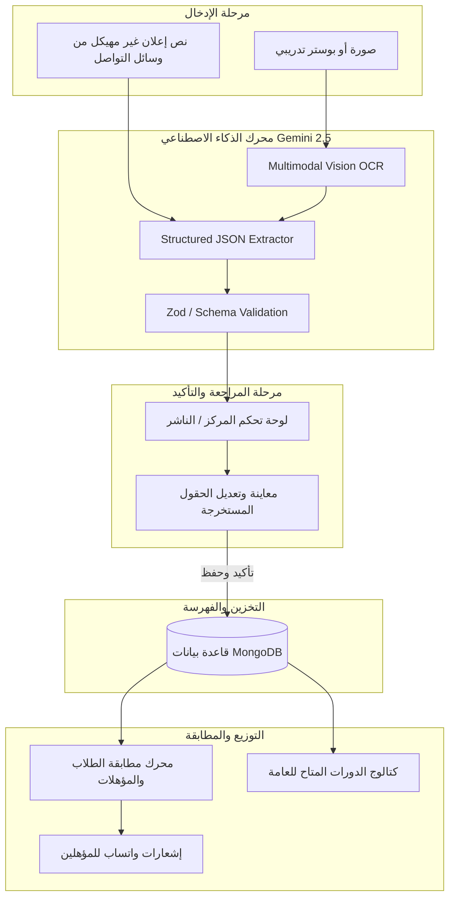

# الورقة البحثية والمخطط المعماري الشامل لإعادة بناء منصة دوليان (Dolean)
## نحو تطبيق ويب موحد، ذكي، ومتعدد الأدوار مبني بالكامل على Next.js 16 و pnpm و MongoDB و Google Gemini API

---

## 1. الملخص التنفيذي (Executive Summary)

يهدف مشروع **دوليان (Dolean)** إلى سد الفجوة بين طالبي التدريب والتمكين المهني في العالم العربي (وبالأخص الفئات الشابة والمجتمعات المستهدفة) وبين المنظمات والمراكز التدريبية والجهات الأهلية المانحة.
في الهيكلية السابقة، كان المشروع مجزأً إلى:
1. مجلد خادم منفصل بنظام Express.js ومكتبات قديمة (`server/`).
2. واجهة مستخدم سابقة مبنية بنظام Vite React (`client/`).
3. تطبيق ويب أحدث مبني بنظام Next.js داخل مجلد فرعي (`web/`).
4. خدمات مصغرة غير مستخدمة حالياً (`microservices/`).

هذا التشتت أدى إلى تعقيد عمليات النشر (Deployment)، وصعوبة الصيانة، وازدواجية الرموز البرمجية، وتشتت نماذج البيانات، بالإضافة إلى غياب نظام متكامل للأدوار والجهات المنظمة، ومحدودية استخراج بيانات الإعلانات التدريبية.

تُقدم هذه الورقة **المخطط المعماري الشامل (Architectural Blueprint)** لإعادة توحيد المنصة في تطبيق **Next.js واحد في جذر المشروع (Root Monolith)**، مع نقل كافة وظائف الخلفية (Backend) إلى مسارات Next.js Route Handlers و Server Actions، وتطبيق نظام صلاحيات مرن متعدد الأدوار (Multi-Role System)، وفصل دقيق بين **الجهة المقدمة للتدريب** و**الجهة الناشرة له**، مع تزويد المراكز بلوحة تحكم متطورة مدعومة بمحرك ذكاء اصطناعي فائق الذكاء عبر **Google Gemini 2.5 Flash** لقراءة النصوص والبوسترات وتحويلها فوراً إلى كائنات بيانات مهيكلة ومفهرسة.

---

## 2. مبررات القرارات التقنية والمعمارية (Architectural Decision Records - ADR)

### 2.1 الانتقال إلى معمارية موحدة في جذر المشروع (Unified Root Next.js)
* **المشكلة السابقة:** وجود 3 مشاريع Node.js منفصلة (`server`, `client`, `web`) داخل مستودع واحد بدون Monorepo tooling حديث، مما يجعل النشر على استضافات مثل Vercel أو Hostinger أو VPS يتطلب إعدادات Docker متعددة الحاويات وتكاليف استضافة وتزامن معقدة.
* **القرار المعماري:** نقل تطبيق Next.js ليحتل جذر المشروع (`/`) بالكامل. استبدال خادم Express بالكامل بـ Next.js Route Handlers (`app/api/...`) و Server Actions.
* **الفائدة المحققة:**
  - نشر موحد (Single Deployment Unit) بضغطة زر واحدة أو عبر CI/CD Pipeline مباشر.
  - مشاركة أنواع البيانات (TypeScript Types/Interfaces) بين الواجهة والخلفية دون الحاجة لمستودعات حزم داخلية.
  - كفاءة استهلاك الموارد وسرعة الاستجابة من خلال Next.js Edge و Node.js Runtimes.

### 2.2 الاحتفاظ بـ MongoDB بدلاً من الانتقال إلى Supabase
* **التقييم المقارن:**
  - **Supabase (PostgreSQL):** يوفر ميزات قوية في العلاقات الصارمة، لكنه يفرض تعقيداً كبيراً في التعامل مع بيانات الدورات المتغيرة ديناميكياً (مثل الشروط التفصيلية، المواعيد المتغيرة، استخراجات الذكاء الاصطناعي متعددة الصيغ).
  - **MongoDB:** يتيح مرونة فائقة (Document Model) لتخزين بنية الإعلانات غير المتجانسة، واستيعاب نتائج تحليل Gemini المتطورة، وسهولة الفلترة المتداخلة (Nested Criteria Filtering) الخاصة بمطابقة أعمار الطلاب ومستوياتهم التعليمية واهتماماتهم، بالإضافة إلى استمرارية البيانات التاريخية للمشروع.
* **القرار:** اعتماد **MongoDB** عبر **Mongoose** ومحرك الاتصال المجمع (Connection Pooling Singleton) المصمم خصيصاً لبيئات Next.js بدون تسريب الاتصالات (Zero Connection Leaks).

### 2.3 محرك الذكاء الاصطناعي: Google Gemini API
* **المشكلة السابقة:** كان المشروع يستخدم واجهة OpenAI/NVIDIA API بنموذج `nemotron` لاستخراج النصوص، دون القدرة على قراءة بوسترات الصور، ومع غياب التحقق من التزام المخرجات بهيكلية JSON الرسمية.
* **الحل المعتمد:** اعتماد مكتبة `@google/genai` ونموذج **Gemini 2.5 Flash / Flash-Lite**:
  - **الرؤية الحاسوبية متعددة الوسائط (Multimodal OCR & Vision):** تحليل الصور وبوسترات الإعلانات مباشرة واستخراج تفاصيل الدورة، والشروط، والمواعيد، والجهة الراعية، حتى مع وجود خطوط عربية مزخرفة.
  - **المخرجات المهيكلة المضمونة (Guaranteed Structured Outputs):** تفعيل خاصية `responseMimeType: "application/json"` و `responseSchema` لضمان الحصول على كائن مطابق تماماً لمخطط Zod/Mongoose دون أي أخطاء في الـ Parsing.

---

## 3. معمارية الصلاحيات والأدوار (Multi-Role & Identity Architecture)

في الواقع العملي لمشروع دوليان، لا يكفي تصنيف المستخدم كـ `admin` أو `user`، لأن المستخدم قد يكون طالباً يبحث عن دورات، وفي نفس الوقت مديراً لمركز تدريبي، أو ناشراً معتمداً.

### 3.1 هيكل الأدوار المتعددة (Multi-Role Taxonomy)
المستخدم يمتلك مصفوفة أدوار: `roles: UserRole[]`:

| الدور (Role) | الوصف والصلاحيات |
| :--- | :--- |
| `student` / `user` | المستخدم العادي؛ يمكنه استعراض الدورات، إكمال ملفه الشخصي ومطابقته بالدورات، والتقديم والتلقي لإشعارات واتساب المناسبة. |
| `center_admin` | ممثل مركز تدريبي أو جمعية؛ يمتلك حق الوصول إلى لوحة تحكم المركز، إضافة دورات باسم مركزه، وعرض المتقدمين المهتمين. |
| `publisher` | جهة أو شخص معتمد لنشر إعلانات الدورات للجهات المختلفة بعد مراجعتها وتصنيفها. |
| `super_admin` | الإدارة العليا للمنصة؛ تحكم كامل بالنظام والمستخدمين، والموافقة على المراكز المعتمدة، وإدارة حملات الإشعارات الجماعية. |

### 3.2 الفصل الدقيق بين "الجهة المقدمة" و"الجهة الناشرة"
لضمان الشفافية والمصداقية، تم تصميم المنظومة لتمييز مفهومين رئيسيين في كل تدريب:
1. **الجهة المقدمة للتدريب (Providing Entity):**
   - هي الهيئة أو المنظمة أو المركز أو الجامعة التي تنفذ التدريب الفعلي وتقدم الشهادات (مثال: "جمعية سنبلة"، "منظمة بنفسج"، "الجامعة اللبنانية").
   - ترتبط بسجل رسمي يتضمن: الاسم، الشعار، النطاق، ومجالات الاختصاص.
2. **الجهة الناشرة للتدريب (Publishing Entity):**
   - هي الجهة أو الحساب الذي قام بإدخال الإعلان ومراجعته وتأكيده على المنصة (مثال: فريق "منصة دوليان"، أو ممثل معتمد للمركز نفسه).
   - يفيد هذا الفصل في الحالات التالية:
     - قيام فريق دوليان برصد إعلانات عامة من جهات مختلفة ونشرها لخدمة الطلاب تحت هوية الجهة المقدمة مع إيضاح أن الناشر هو دوليان.
     - قيام المركز نفسه بنشر دوراته ذاتياً.

---

## 4. تدفق العمليات (System Workflows)



---

## 5. هيكلية المجلدات المستهدفة للتطبيق الموحد (Target Project Structure)

سيتم تفريغ كافة الوحدات القديمة ودمج النظام في الهيكل القياسي الموحد التالي في جذر المستودع:

```text
dolean/
├── docs/                      # مجلد التوثيق الشامل، المخططات، والمراجع البرمجية
│   ├── README.md
│   ├── ARCHITECTURE_BLUEPRINT.md
│   ├── DATABASE_SCHEMA.md
│   ├── GEMINI_AI_SPECIFICATION.md
│   └── MIGRATION_ROADMAP.md
├── public/                    # الأصول الثابتة (الصور، الأيقونات، الخطوط)
├── src/
│   ├── app/                   # مسارات Next.js 16 App Router
│   │   ├── (public)/          # الصفحات العامة (الرئيسية، استعراض الدورات، التفاصيل)
│   │   │   ├── page.tsx
│   │   │   ├── courses/
│   │   │   └── about/
│   │   ├── (auth)/            # مسارات المصادقة
│   │   │   ├── login/
│   │   │   ├── register/
│   │   │   └── forgot-password/
│   │   ├── (dashboard)/       # لوحات التحكم المحمية بنظام الأدوار
│   │   │   ├── student/       # الملف الشخصي والاهتمامات ومتابعة الدورات
│   │   │   ├── center/        # لوحة تحكم المراكز وإضافة الدورات عبر AI
│   │   │   └── admin/         # لوحة الإدارة العامة والإحصائيات والتحكم
│   │   ├── api/               # مسارات الواجهة الخلفية البديلة لـ Express
│   │   │   ├── auth/          # endpoints تسجيل الدخول والتسجيل وJWT
│   │   │   ├── courses/       # CRUD الدورات وعمليات الفلترة
│   │   │   ├── ai/
│   │   │   │   ├── parse-text/   # تحليل النصوص بواسطة Gemini
│   │   │   │   └── parse-image/  # تحليل الصور بواسطة Gemini Multimodal
│   │   │   ├── centers/       # إدارة المراكز والجهات
│   │   │   ├── students/      # ملفات الطلاب وتفاصيل المؤهلات
│   │   │   └── notifications/ # خدمات إرسال رسائل الواتساب
│   │   ├── layout.tsx
│   │   └── globals.css
│   ├── components/            # مكونات React القابلة لإعادة الاستخدام
│   │   ├── ui/                # مكونات التصميم الأساسية (Buttons, Inputs, Modals)
│   │   ├── forms/             # نماذج الإدخال ومعالجة البيانات
│   │   ├── courses/           # بطاقات الدورات وقوائم الفلترة
│   │   └── center-dashboard/  # مكونات لوحة المراكز وساحر إضافة الدورات
│   ├── lib/                   # دوال ومكتبات البنية التحتية
│   │   ├── db.ts              # موصل MongoDB المجمع المحمي من تكرار الاتصال
│   │   ├── gemini.ts          # إعداد وتكامل مكتبة @google/genai
│   │   ├── auth.ts            # إدارة جلسات JWT والتحقق من الصلاحيات (RBAC)
│   │   ├── wa.ts              # خدمة إرسال إشعارات واتساب
│   │   └── validations/       # مخططات التحقق من صحة البيانات (Zod Schemas)
│   └── models/                # نماذج Mongoose لقاعدة البيانات
│       ├── User.ts
│       ├── Organization.ts    # بيانات المراكز والجهات المقدمة والناشرة
│       ├── Course.ts
│       ├── StudentProfile.ts
│       └── DefCourse.ts       # مسودات الإعلانات قبل المعالجة
├── .env.example
├── next.config.ts
├── package.json               # حزم الاعتماديات الموحدة
├── tsconfig.json
└── tailwind.config.ts
```

---

## 6. استراتيجية الأمان وحماية البيانات (Security & Governance)

1. **حماية التوثيق بواسطة JWT و HTTP-Only Cookies:**
   - التخلص من تخزين رموز الدخول في `localStorage` أو `document.cookie` المعرضة لهجمات XSS، والاعتماد على ملفات تعريف ارتباط مشفرة بـ `HttpOnly` و `SameSite=Lax`.
2. **وسيط الصلاحيات (Middleware RBAC):**
   - تفعيل `src/middleware.ts` في Next.js للتحقق من الأدوار قبل تحميل أي صفحة أو استدعاء أي مسار API.
3. **التحقق من صحة المدخلات (Input Sanitization):**
   - استخدام مكتبة **Zod** للتحقق من جميع أطر البيانات المستقبلة عبر استدعاءات API أو نماذج الواجهة.
4. **تأمين مفاتيح API الخاصة بـ Gemini و WhatsApp:**
   - بقاء المفاتيح محصورة في بيئة الخادم (`process.env.GEMINI_API_KEY`) دون كشف أي بادئة `NEXT_PUBLIC_` تتيح للمتصفح رؤيتها.
