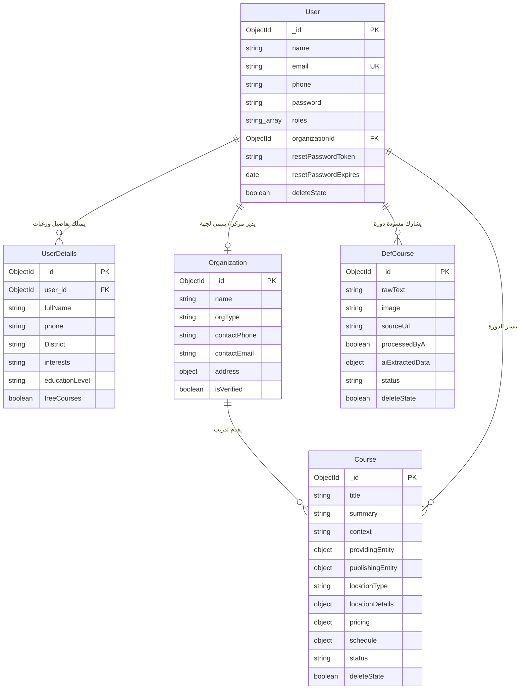
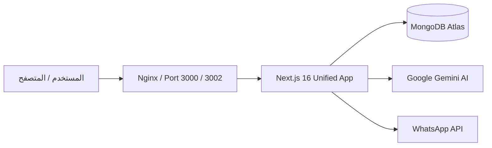

# وثيقة متطلبات ومعمارية المنتج (PRD) - منصة دوليان (Dolean)

> **الإصدار:** 2.0.0 (Unified Architecture)  
> **تاريخ التحديث:** أكتوبر 2026  
> **حالة المشروع:** قيد التشغيل والتطوير المستمر (Active Production/Development)  
> **البيئة المعتمدة:** Next.js 16 (App Router) + Turbopack + Node.js 20+

---

## 📑 جدول المحتويات (Table of Contents)
1. [نظرة عامة على المشروع (Project Overview)](#1-نظرة-عامة-على-المشروع-project-overview)
2. [المكدس التقني (Tech Stack)](#2-المكدس-التقني-tech-stack)
3. [بنية وهيكلية الملفات (File Structure)](#3-بنية-وهيكلية-الملفات-file-structure)
4. [معمارية ونماذج قواعد البيانات (Database Schema & Models)](#4-معمارية-ونماذج-قواعد-البيانات-database-schema--models)
5. [الأمان والحماية وإدارة الصلاحيات (Security Rules & RBAC)](#5-الأمان-والحماية-وإدارة-الصلاحيات-security-rules--rbac)
6. [التكاملات الخارجية ومحركات المعالجة (External Integrations)](#6-التكاملات-الخارجية-ومحركات-المعالجة-external-integrations)
7. [معمارية النشر والحاويات (Deployment & Docker Architecture)](#7-معمارية-النشر-والحاويات-deployment--docker-architecture)

---

## 1. نظرة عامة على المشروع (Project Overview)

### 1.1 اسم المشروع
**منصة دوليان (Dolean)** — بوابة التمكين المهني والربط الأكاديمي والتدريبي في الشمال السوري.

### 1.2 الرؤية والرسالة
* **الرؤية:** أن تصبح "دوليان" المنصة المركزية والموثوقة الأولى في الشمال السوري (محافظة إدلب والمناطق المحيطة) لجمع، تدقيق، وعرض كافة الفرص التدريبية والمهنية.
* **الرسالة:** ربط الطلاب والباحثين عن مهارات بسوق العمل والمراكز التدريبية الشريكة، وتمكين المعاهد والمنظمات من استقطاب المستفيدين الأكثر حاجة وتنسيق الدورات بكفاءة وسرعة.

### 1.3 الجمهور المستهدف (Target Audiences)
1. **الطلاب والشباب والباحثون عن عمل:** استكشاف الدورات المجانية والمدفوعة، طلب دورات مخصصة، والحصول على إشعارات فورية عبر واتساب عند توفر مقاعد.
2. **المراكز والمعاهد التدريبية والمنظمات (NGOs):** إدارة ونشر الإعلانات، استعراض بيانات الطلاب المهتمين، واستقطاب المرشحين المناسبين.
3. **المجتمع المحلي والمساهمون:** مشاركة إعلانات الدورات من الشارع وشبكات التواصل لتفريغها ومراجعتها.
4. **إدارة المنصة (Platform Admins):** الإشراف والموافقة على المسودات، إدارة المستخدمين، والتواصل الجماعي عبر الواتساب.

---

## 2. المكدس التقني (Tech Stack)

تم توحيد المنصة بالكامل في بنية **Unified Monolith** عالية الأداء تعتمد أحدث معايير الويب:

| الطبقة (Layer) | التقنية المختارة | الإصدار | الوظيفة / السبب |
| :--- | :--- | :--- | :--- |
| **Framework** | **Next.js (App Router)** | `16.4.3` | الخادم والواجهة معاً (SSR/SSG/Server Actions/API Routes)، مع Turbopack لسرعة البناء. |
| **Core Runtime** | **React** | `19.0.0` | استخدام أحدث ميزات React Server Components و React Hook Forms الحديثة. |
| **Language** | **TypeScript** | `5.7.3` | بيئة عمل منضبطة بالكامل بنمط Strict Typing لضمان خلو الأكواد من الأخطاء أثناء التشغيل. |
| **Package Manager**| **pnpm** | `Latest` | إدارة سريعة وفعالة للحزم والمكتبات بدون تكرار الحزم في القرص. |
| **Database** | **MongoDB (Atlas)** | `v8.x` | قاعدة بيانات NoSQL مرنة لتخزين الدورات، الطلاب، المراكز، وسجلات التقديم. |
| **ODM Engine** | **Mongoose** | `8.10.1` | إدارة نماذج البيانات والمخططات وعلاقات الوثائق مع نمط الاتصال الأحادي (Singleton). |
| **Styling & UI** | **Tailwind CSS** | `3.4.17` | تنسيق مرن وسريع، دعم RTL عربي كامل، وتصميم بشري نظيف (Anti-AI Bloat). |
| **Icons & Visuals**| **Lucide React** | `0.475.0` | مكتبة أيقونات متناسقة واحترافية بدون رموز ذكاء اصطناعي مشتتة. |
| **Auth & Crypto** | **JWT & Bcryptjs** | `9.0.2 / 3.0.2` | تشفير كلمات المرور برتبة 10 ملح وإصدار توكنات آمنة للمصادقة وتعيين كلمات المرور. |
| **AI Integration** | **Google Gemini SDK** | `@google/genai ^2.31.0` | استخراج وتصنيف بيانات الدورات آلياً من النصوص والصور غير المهيكلة (Multimodal Vision). |
| **WhatsApp Gateway**| **Taykom API / waSend** | `Axios REST` | إرسال رسائل وإشعارات فورية للطلاب والمراكز عبر أرقام هواتفهم. |

---

## 3. بنية وهيكلية الملفات (File Structure)

تعتمد المنصة معمارية Next.js App Router الموحدة، حيث توجد كافة مسارات الواجهة ومسارات الخادم (Backend APIs) تحت مجلد `src/`:

```plaintext
dolean/
├── docs/                                  # التوثيق المعماري ومخططات قواعد البيانات
│   ├── ARCHITECTURE_BLUEPRINT.md
│   ├── DATABASE_SCHEMA.md
│   ├── GEMINI_AI_SPECIFICATION.md
│   ├── MIGRATION_ROADMAP.md
│   ├── UI_UX_DESIGN_SYSTEM.md
│   └── PRD.md                             # وثيقة متطلبات ومعمارية المنتج (هذا الملف)
├── public/                                # الأصول الثابتة (الصور، الشعارات، الخطوط)
├── src/
│   ├── app/                               # مسارات التطبيق (App Router Pages & APIs)
│   │   ├── layout.tsx                     # الغلاف العام للتطبيق (Nav, Footer, Providers)
│   │   ├── page.tsx                       # الصفحة الرئيسية (Hero, Courses Feed, Partners, FAQ)
│   │   │
│   │   ├── admin/                         # لوحة تحكم الإدارة (Admin Dashboard)
│   │   │   ├── page.tsx                   # الإحصائيات العامة
│   │   │   ├── courses/                   # إدارة الدورات المنشورة
│   │   │   ├── def-courses/               # مسودات الدورات المعلقة للمراجعة والاعتماد
│   │   │   ├── users/                     # إدارة الحسابات والصلاحيات
│   │   │   ├── users-details/             # رغبات واحتياجات الطلاب التدريبية
│   │   │   └── ai-course/                 # معالجة الإعلانات عبر Gemini وتوليد الدورات
│   │   │
│   │   ├── api/                           # خادم الـ REST API الداخلي (Next.js API Routes)
│   │   │   ├── auth/                      # مسارات المصادقة
│   │   │   │   ├── route.ts               # جلب بيانات المستخدم الحالي (GET /api/auth)
│   │   │   │   ├── login/route.ts         # تسجيل الدخول (POST /api/auth/login)
│   │   │   │   ├── signup/route.ts        # إنشاء حساب جديد (POST /api/auth/signup)
│   │   │   │   ├── reset-password/route.ts# طلب استعادة كلمة المرور (POST)
│   │   │   │   └── new-password/route.ts  # تعيين كلمة المرور الجديدة بالرمز (POST)
│   │   │   ├── admin/                     # مسارات الإدارة الداخلية (إحصائيات، مستخدمين، واتساب)
│   │   │   ├── ai/extract/route.ts        # مسار استخراج تفاصيل الدورة بالذكاء الاصطناعي
│   │   │   ├── student/                   # مسارات الطالب (الملف الشخصي والتقديم)
│   │   │   └── centers/                   # مسارات المراكز والمعاهد
│   │   │
│   │   ├── apply/                         # صفحة طلب دورة تدريبية مخصصة (Student Application)
│   │   ├── auth/                          # صفحات المصادقة (دخول، تسجيل، استعادة، تعيين جديد)
│   │   ├── center/                        # بوابة انضمام وتسجيل المراكز والمعاهد
│   │   ├── courses/                       # دليل استعراض الدورات والفلترة وبحث التفاصيل
│   │   ├── profile/                       # صفحة الملف الشخصي للطالب
│   │   ├── share/                         # بوابة المساهمة المجتمعية لمشاركة إعلانات الدورات
│   │   └── tasks/                         # متابعة حالة الطلبات والمهام
│   │
│   ├── components/                        # مكونات واجهة المستخدم (Reusable UI Components)
│   │   ├── Element/                       # حقول النماذج وعناصر الإدخال الأساسية
│   │   ├── forms-client/                  # النماذج التفاعلية (HeroQuickRequest, editprofile)
│   │   ├── theme/                         # المكونات الهيكلية (Nav, Footer, Logo, HowItWorks)
│   │   └── ui/                            # المكونات المساعدة ومحاكيات التحميل (Skeleton Grids)
│   │
│   ├── lib/                               # الدوال المساعدة والخدمات المركزية (Core Services)
│   │   ├── db.ts                          # موصل MongoDB بنمط Singleton المحمي
│   │   ├── auth.ts                        # خوارزميات التشفير والتحقق من JWT والصلاحيات (RBAC)
│   │   ├── gemini.ts                      # محرك استخراج البيانات عبر Google Gemini API
│   │   ├── wa.ts                          # خدمة إرسال رسائل WhatsApp التلقائية
│   │   └── utils.ts                       # أدوات مساعدة عامة لتنسيق الفئات والنصوص
│   │
│   └── models/                            # نماذج ومخططات قاعدة البيانات (Mongoose Models)
│       ├── User.ts                        # نموذج المستخدمين والصلاحيات
│       ├── Course.ts                      # نموذج الدورات التدريبية المعتمدة
│       ├── DefCourse.ts                   # مسودات الدورات قبل النشر (Drafts)
│       ├── Organization.ts                # بيانات المعاهد والمراكز الشريكة
│       ├── UserDetails.ts                 # تفاصيل ورغبات الطلاب التدريبية
│       └── waInit.ts                      # بيانات اعتماد بوابة الواتساب
│
├── .env                                   # المتغيرات البيئية ومفاتيح الاتصال
├── package.json                           # الحزم والمكتبات والاعتماديات
├── tailwind.config.ts                     # إعدادات التصميم والألوان والخطوط
└── tsconfig.json                          # إعدادات مفسر TypeScript
```

---

## 4. معمارية ونماذج قواعد البيانات (Database Schema & Models)

تعتمد قاعدة بيانات **MongoDB** 6 نماذج رئيسية ترتبط فيما بينها لضمان تدفق البيانات بسلاسة وأمان:



### 4.1 تفاصيل النماذج الرئيسية:

#### 1. نموذج المستخدم (`User.ts`)
* **المسار:** [src/models/User.ts](file:///d:/projects/dolean/src/models/User.ts)
* **الأدوار المدعومة (`roles`):**
  * `student`: طالب / مستفيد يبحث عن تدريب.
  * `center_admin`: مدير معهد أو مركز تدريبي شريك.
  * `publisher`: ناشر ومراجع إعلانات معتمد.
  * `admin` / `super_admin`: إدارة كاملة للنظام، للمستخدمين، وتعديل الإعدادات.
* **الحقول الرئيسية:**
  * `email`: فريد مع تحويل تلقائي للأحرف الصغيرة (`lowercase`, `trim`).
  * `phone`: رقم الهاتف مع فهرسة للبحث السريع (`index: 1`).
  * `resetPasswordToken` و `resetPasswordExpires`: رمز استعادة كلمة المرور وصلاحيته (لمدة 1 ساعة).
  * `deleteState`: للحذف الناعم (Soft Delete).

#### 2. نموذج الدورة المعتمدة (`Course.ts`)
* **المسار:** [src/models/Course.ts](file:///d:/projects/dolean/src/models/Course.ts)
* **الكيان المزدوج:**
  * **الجهة المقدمة للتدريب (`providingEntity`):** المعهد أو الجمعية التي تقدم المحتوى العملي والشهادة (مثل: معهد الأمل، منظمة بنفسج).
  * **الجهة الناشرة (`publishingEntity`):** المستخدم أو الطرف الذي أدخل الإعلان (المنصة، محرر خارجي، أو المركز نفسه).
* **الموقع:** `locationType` (`online`, `in_person`, `hybrid`) مع تفاصيل المدينة والبلدة (تركيز أساسي على **إدلب**).
* **التسعير:** مجانية (`isFree: true`)، أو مدفوعة مع إمكانية توفير منحة مالية للمتدربين (`stipendProvided`).

#### 3. مسودة الدورة (`DefCourse.ts`)
* **المسار:** [src/models/DefCourse.ts](file:///d:/projects/dolean/src/models/DefCourse.ts)
* تمثل الوعاء الذي يستقبل الإعلانات الخام (نصوص الإعلانات في واتساب وتلغرام، أو صور البروشورات).
* يتم إرسالها إلى محرك الذكاء الاصطناعي (`processedByAi: true`) ليتم تفريغها في `aiExtractedData`، ثم مراجعتها من الأدمن واعتمادها لتتحول إلى `Course` معتمد.

#### 4. المنظمات والمراكز (`Organization.ts`)
* **المسار:** [src/models/Organization.ts](file:///d:/projects/dolean/src/models/Organization.ts)
* يوثق بيانات المراكز والمعاهد الرسمية، ونوعها (`institute`, `ngo`, `university`, `company`).
* يدعم التوثيق الرسمي عبر حقل `isVerified: boolean`.

#### 5. رغبات وبيانات الطلاب (`UserDetails.ts`)
* **المسار:** [src/models/UserDetails.ts](file:///d:/projects/dolean/src/models/UserDetails.ts)
* يسجل اهتمامات الطلاب التدريبية، المنطقة المفضلة، المستوى التعليمي، وإتقان الحاسوب واللغة، لمطابقتهم آلياً مع الدورات القادمة.

---

## 5. الأمان والحماية وإدارة الصلاحيات (Security Rules & RBAC)

تتبع المنصة أفضل ممارسات الحماية الحديثة في معمارية Next.js:

### 5.1 نموذج المصادقة (Authentication Architecture)
* **التشفير:** استخدام مكتبة `bcryptjs` لتشفير كلمات المرور بـ 10 Salt Rounds. لا يتم تخزين أو إرجاع كلمات المرور النصية نهائياً.
* **إصدار التوكنات (JWT Tokens):** يتم توقيع التوكن بمفتاح سري مشفر (`JWT_SECRET`) مع فترة صلاحية محددة بـ 7 أيام (`7d`).
* **تخزين التوكن:** يُخزن في كوكيز المتصفح (`authorization`)، مع إرساله في الـ Headers (`Authorization: Bearer <token>`) أثناء استدعاءات الخادم.

### 5.2 إدارة الصلاحيات المبنية على الأدوار (RBAC)
تعتمد المنصة الدالة المركزية **`requireAuth(req, allowedRoles)`** الموجودة في [src/lib/auth.ts](file:///d:/projects/dolean/src/lib/auth.ts):

```typescript
// آلية التحقق من الصلاحيات
export async function requireAuth(req: NextRequest, allowedRoles?: string[]): Promise<IUser | null> {
  const user = await getAuthUser(req);
  if (!user || user.deleteState) return null;

  if (allowedRoles && allowedRoles.length > 0) {
    const hasPermission = allowedRoles.some((role) => user.roles.includes(role as UserRole));
    if (!hasPermission) return null;
  }
  return user;
}
```

* **مصفوفة الصلاحيات حسب المسار:**
  * **مسارات الطلاب (`/api/student/*`):** متاحة لأي مستخدم مسجل (`student`, `user`, `admin`).
  * **مسارات المراكز (`/api/centers/*`):** متاحة لـ `center_admin` و `admin`.
  * **مسارات لوحة التحكم والإشراف (`/api/admin/*`):** محمية بالكامل، ومقصورة فقط على `admin` و `super_admin`.
  * **مسارات المشاركة العامة (`/api/student/apply`, `/share`):** مفتوحة للزوار والطلاب مع تطهير البيانات المدخلة.

### 5.3 أمان استعادة كلمة المرور (Password Reset Security)
* عند طلب استعادة كلمة المرور عبر `POST /api/auth/reset-password`:
  1. يتم توليد رمز عشوائي مشفر بالكامل بحجم 32 بايت (`crypto.randomBytes(32).toString('hex')`).
  2. تحديد صلاحية زمنية مدتها **60 دقيقة فقط** في قاعدة البيانات.
  3. إبطال الرمز فور استخدامه عبر `POST /api/auth/new-password`.
  4. فرض ألا تقل كلمة المرور الجديدة عن 8 خانات.

### 5.4 سلامة البيانات والحذف الناعم (Soft Delete)
* جميع النماذج الحساسة مزودة بحقل `deleteState: boolean`.
* لا يتم تطبيق الحذف الصلب (`Hard DELETE / DROP`)، بل تُستثنى السجلات المحذوفة تلقائياً عبر فلتر `{ deleteState: false }`.

---

## 6. التكاملات الخارجية ومحركات المعالجة (External Integrations)

### 6.1 محرك استخراج الإعلانات الذكي (Google Gemini AI)
* **المسار:** [src/lib/gemini.ts](file:///d:/projects/dolean/src/lib/gemini.ts)
* **النموذج:** `gemini-3.8-flash` و `gemini-2.5-flash`.
* **الوظيفة:**
  1. استقبال نصوص إعلانات الدورات الطويلة أو الملصقات الصورية عبر الرؤية الحاسوبية (Multimodal Vision).
  2. تحويل الإعلان الخام إلى كائن JSON منضبط يحدد: اسم الدورة، الجهة المنظمة، مكان التدريب، الفئة العمرية المستهدفة، شروط التسجيل، والمواعيد بدقة.

### 6.2 بوابة الرسائل التلقائية عبر واتساب (WhatsApp Gateway)
* **المسار:** [src/lib/wa.ts](file:///d:/projects/dolean/src/lib/wa.ts)
* **الوظيفة:**
  1. إرسال روابط تعيين كلمة المرور للمستخدم عند طلبها عبر رسالة واتساب فورية لرقم هاتفه.
  2. إرسال تنبيهات مطابقة فورية عند افتتاح مقاعد جديدة في دورات تناسب رغبة الطالب المسجلة في إدلب.

---

## 7. معمارية النشر والحاويات (Deployment & Docker Architecture)

بعد إتمام توحيد المشروع والاستغناء عن نظام التطبيقات المتفرقة القديم (`server/` و `client/`)، أصبحت معمارية النشر تعتمد حاوية تشغيل واحدة ومحكمة:

### 7.1 الحاوية الموحدة (Unified Dockerfile Pattern)
بدلاً من تشغيل حاويتين منفصلتين للمخدم والعميل، يتم بناء التطبيق وتشغيله كحاوية Next.js مستقلة (Standalone):



* **المميزات:**
  * استهلاك أقل للذاكرة بنسبة 60% مقارنة بالتشغيل المنفصل.
  * التخلص من مشاكل CORS وتباين المنافذ بين المتصفح والخادم (Zero CORS Issues).
  * سهولة النشر على بيئات Vercel أو خوادم VPS (Docker Compose) بملف واحد وبيئة متطابقة.

---

> **ملاحظة توثيقية:** تم إعداد هذه الوثيقة وتحديثها لتكون المرجع الرسمي للمطورين ومدراء المنتج عند إضافة ميزات جديدة أو مراجعة معمارية النظام.
